# HelpCore — Diagrama ER e Dicionário de Dados v0.1

**Projeto:** HelpCore / ITDESK  
**Repositório:** klbsilva/HelpCore-v-1  
**Status:** proposta técnica para revisão e aprovação do Product Owner  
**Base:** especificação funcional v1.0 e decisões registradas em DATA-MODEL-v0.2  
**Banco:** PostgreSQL  
**Escopo:** modelo lógico detalhado. Não contém migrations nem autoriza implementação.

## 1. Decisões de produto incorporadas

- Login de supervisores por username único + senha; e-mail é contato/notificação e obrigatório para supervisores ativos.
- Cada supervisor administra exatamente uma equipe na V1.
- Um chamado pode ser relacionado a vários incidentes; cada vínculo é explícito e auditado.
- Funcionários afetados não possuem conta de acesso.
- Todo funcionário ativo deve possuir exatamente um vínculo atual com uma equipe.
- Mensagens internas/observações da TI são permitidas e visíveis somente a administradores e técnicos autorizados; supervisores não podem acessá-las.
- Incidentes possuem protocolo próprio com prefixo INC (ex.: INC-0001).
- A visibilidade dos chamados acompanha o vínculo atual do funcionário (HC-067).
- Kléber e Felipe são administradores equivalentes; Kléber é o técnico inicial e recebe novos chamados.
- Reabertura mantém o protocolo principal e cria um novo ciclo.
- Chamados são arquivados, não excluídos definitivamente pela interface.

## 2. Convenções de dados

- IDs internos: UUID.
- Datas: timestamptz, armazenadas em UTC.
- Fuso de expediente: America/Sao_Paulo.
- Valores monetários não são necessários no domínio inicial.
- Estados e tipos devem ser enums controlados ou tabelas de referência, conforme a decisão de implementação.
- Campos de auditoria comuns: created_at, created_by, updated_at, updated_by quando aplicáveis.
- Dados pessoais devem ser minimizados. Para funcionário afetado, não armazenar CPF, telefone pessoal ou dados sensíveis sem necessidade operacional e aprovação.
- Campos de senha contêm apenas hash; nunca texto puro.
- Nomes de arquivos e chaves de storage não devem permitir acesso público.

## 3. Diagrama ER

O diagrama apresenta entidades e cardinalidades centrais. Campos auxiliares, índices e algumas relações de auditoria estão detalhados nas seções seguintes.

```mermaid
erDiagram
    USERS ||--o{ USER_ROLES : has
    ROLES ||--o{ USER_ROLES : assigned
    ROLES ||--o{ ROLE_PERMISSIONS : grants
    PERMISSIONS ||--o{ ROLE_PERMISSIONS : included
    USERS ||--o{ SESSIONS : opens
    USERS ||--o{ TEAMS : supervises
    TEAMS ||--o{ EMPLOYEE_TEAM_ASSIGNMENTS : contains
    EMPLOYEES ||--o{ EMPLOYEE_TEAM_ASSIGNMENTS : assigned_over_time

    USERS ||--o{ TICKETS : requests
    USERS ||--o{ TICKETS : supervisor_at_open
    EMPLOYEES ||--o{ TICKETS : affected
    SERVICE_CATEGORIES ||--o{ TICKETS : classifies
    SERVICES ||--o{ TICKETS : impacts
    TICKETS ||--|{ TICKET_CYCLES : has
    TICKETS ||--o{ TICKET_STATUS_EVENTS : status_history
    TICKETS ||--o{ TICKET_PRIORITY_EVENTS : priority_history
    TICKET_CYCLES ||--o{ TICKET_ASSIGNMENTS : assigned_periods
    USERS ||--o{ TICKET_ASSIGNMENTS : technician
    TICKET_CYCLES ||--o{ TICKET_MESSAGES : contains
    USERS ||--o{ TICKET_MESSAGES : writes
    TICKETS ||--o{ TICKET_REQUESTS : receives
    USERS ||--o{ TICKET_REQUESTS : requests_or_decides
    TICKET_REQUESTS ||--o{ TICKET_EDIT_GRANTS : authorizes
    TICKETS ||--o{ TICKET_TIME_EVENTS : measures

    TICKETS ||--o{ TICKET_ATTACHMENTS : has
    TICKET_MESSAGES ||--o{ MESSAGE_ATTACHMENTS : includes
    ATTACHMENTS ||--o{ MESSAGE_ATTACHMENTS : linked
    ATTACHMENTS ||--o{ TICKET_ATTACHMENTS : linked

    INCIDENTS ||--o{ INCIDENT_TICKET_LINKS : groups
    TICKETS ||--o{ INCIDENT_TICKET_LINKS : associated

    SERVICES ||--o{ SERVICE_STATUS_HISTORY : status
    SERVICES ||--o{ INCIDENTS : affected
    USERS ||--o{ ANNOUNCEMENTS : publishes
    ANNOUNCEMENTS ||--o{ ANNOUNCEMENT_ACKNOWLEDGEMENTS : acknowledged
    USERS ||--o{ ANNOUNCEMENT_ACKNOWLEDGEMENTS : confirms

    BUSINESS_CALENDARS ||--o{ CALENDAR_WORK_INTERVALS : weekly_schedule
    BUSINESS_CALENDARS ||--o{ CALENDAR_EXCEPTIONS : defines
    CALENDAR_EXCEPTIONS ||--o{ CALENDAR_EXCEPTION_WORK_INTERVALS : exception_schedule
    SLA_POLICIES ||--o{ TICKET_SLA_INSTANCES : applied
    TICKET_CYCLES ||--o{ TICKET_SLA_INSTANCES : measured

    USERS ||--o{ NOTIFICATIONS : receives
    USERS ||--o{ AUDIT_EVENTS : acts
    USERS ||--o{ EMPLOYEE_TEAM_ASSIGNMENTS : changes
```

Observação: a relação entre USERS e TEAMS é 1:N no desenho físico geral, mas a regra de negócio V1 limita cada supervisor a uma única equipe ativa. Essa restrição deverá ser garantida por constraint/índice e validação transacional.

## 4. Dicionário de dados

### 4.1 Identidade e permissões

#### users
- id UUID PK
- username VARCHAR(80) NOT NULL UNIQUE
- display_name VARCHAR(160) NOT NULL
- email VARCHAR(254) NOT NULL para usuários supervisores ativos — contato e notificações; não é login obrigatório
- password_hash TEXT NOT NULL
- account_status VARCHAR(20) NOT NULL — active, blocked, disabled
- must_change_password BOOLEAN NOT NULL DEFAULT TRUE
- failed_login_count INTEGER NOT NULL DEFAULT 0
- locked_until TIMESTAMPTZ NULL
- last_login_at TIMESTAMPTZ NULL
- created_at, updated_at TIMESTAMPTZ NOT NULL
- created_by, updated_by UUID NULL FK users

Regra: username normalizado para comparação sem distinção de caixa, com unicidade case-insensitive. Não persistir senha provisória em texto puro.

#### roles
- id UUID PK
- code VARCHAR(40) UNIQUE NOT NULL — admin, supervisor, technician
- name VARCHAR(80) NOT NULL
- description TEXT NULL

#### permissions
- id UUID PK
- code VARCHAR(100) UNIQUE NOT NULL
- description TEXT NOT NULL

#### user_roles
- user_id UUID FK users
- role_id UUID FK roles
- assigned_at TIMESTAMPTZ NOT NULL
- assigned_by UUID FK users
- PK composta (user_id, role_id)

#### role_permissions
- role_id UUID FK roles
- permission_id UUID FK permissions
- PK composta (role_id, permission_id)

#### sessions
- id UUID PK
- user_id UUID FK users NOT NULL
- session_token_hash TEXT UNIQUE NOT NULL
- created_at, last_activity_at, expires_at TIMESTAMPTZ NOT NULL
- revoked_at TIMESTAMPTZ NULL
- revoked_by UUID FK users NULL
- revoke_reason VARCHAR(120) NULL
- user_agent_summary VARCHAR(300) NULL
- ip_address INET NULL

Regras: expiração por 3 horas de inatividade; token bruto não armazenado; revogação deve invalidar imediatamente o acesso.

### 4.2 Equipes e funcionários

#### teams
- id UUID PK
- supervisor_user_id UUID FK users NOT NULL
- name VARCHAR(120) NOT NULL
- is_active BOOLEAN NOT NULL DEFAULT TRUE
- created_at, updated_at TIMESTAMPTZ NOT NULL

Regra V1: cada supervisor possui exatamente uma equipe ativa; supervisor_user_id UNIQUE para equipes ativas. Transferência de funcionário não cria nova equipe.

#### employees
- id UUID PK
- full_name VARCHAR(160) NOT NULL
- is_active BOOLEAN NOT NULL DEFAULT TRUE — situação ativo/inativo
- created_at TIMESTAMPTZ NOT NULL — data do cadastro
- created_by UUID FK users NOT NULL — administrador responsável pelo cadastro

O cadastro contém somente nome completo, equipe atual (derivada do vínculo vigente em employee_team_assignments), situação, data do cadastro e responsável pelo cadastro. Não há identificador interno, e-mail, telefone, CPF ou login do funcionário afetado. Alterações de equipe são registradas no histórico de vínculos; a equipe atual não deve ser duplicada como campo editável em employees.

#### employee_team_assignments
- id UUID PK
- employee_id UUID FK employees NOT NULL
- team_id UUID FK teams NOT NULL
- valid_from TIMESTAMPTZ NOT NULL
- valid_to TIMESTAMPTZ NULL
- change_reason TEXT NULL
- changed_by UUID FK users NOT NULL
- created_at TIMESTAMPTZ NOT NULL

Invariantes:
- No máximo um vínculo atual por funcionário (valid_to IS NULL).
- Todo funcionário ativo deve ter exatamente um vínculo atual. Cadastro/ativação sem equipe é bloqueado.
- Transferência fecha o vínculo anterior e cria o novo na mesma transação.
- O banco deve impedir dois vínculos atuais simultâneos, por índice único parcial.
- Alteração deve ser auditada.

### 4.3 Categorias e serviços

#### service_categories
- id UUID PK
- code VARCHAR(50) UNIQUE NOT NULL
- name VARCHAR(100) NOT NULL
- description TEXT NULL
- is_active BOOLEAN NOT NULL DEFAULT TRUE
- display_order SMALLINT NOT NULL

Registros iniciais: Hardware; Software; Rede e Internet; Telefonia; Acessos; Impressoras e periféricos; Solicitação de equipamento; Outros.

#### services
- id UUID PK
- code VARCHAR(60) UNIQUE NOT NULL
- name VARCHAR(120) NOT NULL
- description TEXT NULL
- is_active BOOLEAN NOT NULL DEFAULT TRUE
- created_at, updated_at TIMESTAMPTZ NOT NULL

Catálogo inicial: Internet e rede; Telefonia/MicroSIP; Bitrix24; Sistemas internos; Computadores/notebooks; Impressoras/periféricos; E-mail corporativo; Outros.

#### service_status_history
- id UUID PK
- service_id UUID FK services NOT NULL
- status VARCHAR(20) NOT NULL — operational, unstable, unavailable
- note TEXT NULL
- started_at TIMESTAMPTZ NOT NULL
- ended_at TIMESTAMPTZ NULL
- changed_by UUID FK users NOT NULL
- incident_id UUID FK incidents NULL — relação contextual opcional

Histórico append-only de transições. O estado atual pode ser obtido pelo registro aberto mais recente ou mantido em projeção com consistência transacional.

### 4.4 Chamados e ciclos

#### tickets
- id UUID PK
- protocol_number BIGINT NOT NULL UNIQUE — número sequencial interno para gerar HC-0001
- title VARCHAR(180) NOT NULL
- description TEXT NOT NULL
- employee_id UUID FK employees NOT NULL
- requester_user_id UUID FK users NOT NULL — quem abriu originalmente
- supervisor_at_open_user_id UUID FK users NOT NULL — responsável à época
- category_id UUID FK service_categories NOT NULL
- service_id UUID FK services NULL
- current_priority VARCHAR(20) NOT NULL
- current_status VARCHAR(30) NOT NULL
- current_cycle_id UUID NULL — FK ticket_cycles, adicionada após criação/por constraint diferida conforme estratégia
- created_at, updated_at TIMESTAMPTZ NOT NULL
- resolved_at TIMESTAMPTZ NULL
- closed_at TIMESTAMPTZ NULL
- archived_at TIMESTAMPTZ NULL
- archived_by UUID FK users NULL
- archive_reason VARCHAR(200) NULL

Não apagar chamado. Arquivamento automático 30 dias após fechamento. Autorização de leitura é calculada pelo vínculo atual do employee_id; requester e supervisor_at_open são preservados como fatos históricos.

#### ticket_cycles
- id UUID PK
- ticket_id UUID FK tickets NOT NULL
- cycle_number INTEGER NOT NULL — 0 para inicial; 1 para R1 etc.
- cycle_label VARCHAR(30) NOT NULL — HC-0001, HC-0001-R1...
- priority VARCHAR(20) NOT NULL
- status VARCHAR(30) NOT NULL
- opened_at TIMESTAMPTZ NOT NULL
- resolved_at TIMESTAMPTZ NULL
- closed_at TIMESTAMPTZ NULL
- resolution_summary TEXT NULL
- created_by UUID FK users NOT NULL
- UNIQUE(ticket_id, cycle_number)
- UNIQUE(cycle_label)

Reabertura cria novo ciclo e preserva o anterior. A prioridade inicial do ciclo reaberto é Alta, ajustável por administrador. O protocolo principal não muda.

#### ticket_assignments
- id UUID PK
- ticket_cycle_id UUID FK ticket_cycles NOT NULL
- technician_user_id UUID FK users NOT NULL
- assigned_at TIMESTAMPTZ NOT NULL
- started_at TIMESTAMPTZ NULL
- ended_at TIMESTAMPTZ NULL
- assigned_by UUID FK users NOT NULL
- end_reason VARCHAR(160) NULL

Registra períodos individuais por técnico. Novo chamado recebe atribuição a Kléber. Mudança de técnico fecha o período anterior e abre outro sem apagar histórico.

#### ticket_status_events
- id UUID PK
- ticket_id UUID FK tickets NOT NULL
- ticket_cycle_id UUID FK ticket_cycles NOT NULL
- from_status VARCHAR(30) NULL
- to_status VARCHAR(30) NOT NULL
- changed_by UUID FK users NULL — NULL somente para job/sistema identificado em actor_type
- actor_type VARCHAR(20) NOT NULL — user, system
- reason TEXT NULL
- occurred_at TIMESTAMPTZ NOT NULL

#### ticket_priority_events
- id UUID PK
- ticket_id UUID FK tickets NOT NULL
- ticket_cycle_id UUID FK ticket_cycles NOT NULL
- old_priority VARCHAR(20) NOT NULL
- new_priority VARCHAR(20) NOT NULL
- changed_by UUID FK users NOT NULL
- reason TEXT NULL
- occurred_at TIMESTAMPTZ NOT NULL

### 4.5 Solicitações administrativas

#### ticket_requests
- id UUID PK
- ticket_id UUID FK tickets NOT NULL
- ticket_cycle_id UUID FK ticket_cycles NULL
- request_type VARCHAR(20) NOT NULL — edit, cancel, reopen
- requested_by UUID FK users NOT NULL
- reason TEXT NOT NULL
- request_status VARCHAR(20) NOT NULL — pending, approved, rejected, withdrawn
- decided_by UUID FK users NULL
- decision_note TEXT NULL
- requested_at TIMESTAMPTZ NOT NULL
- decided_at TIMESTAMPTZ NULL

#### ticket_edit_grants
- id UUID PK
- ticket_request_id UUID FK ticket_requests NOT NULL UNIQUE
- ticket_id UUID FK tickets NOT NULL
- granted_user_id UUID FK users NOT NULL
- valid_from TIMESTAMPTZ NOT NULL
- expires_at TIMESTAMPTZ NOT NULL
- used_at TIMESTAMPTZ NULL
- revoked_at TIMESTAMPTZ NULL

Grant somente para chamado e usuário específicos, por 15 minutos. Chamados fechados/arquivados não recebem grant. Operações autorizadas geram histórico de valores antigos/novos e auditoria.

### 4.6 Mensagens e anexos

#### ticket_messages
- id UUID PK
- ticket_id UUID FK tickets NOT NULL
- ticket_cycle_id UUID FK ticket_cycles NOT NULL
- author_user_id UUID FK users NOT NULL
- body TEXT NOT NULL
- message_type VARCHAR(20) NOT NULL — public_reply, internal_note
- created_at TIMESTAMPTZ NOT NULL
- edited_at TIMESTAMPTZ NULL

Regra de autorização obrigatória: internal_note só pode ser consultada por administradores e técnicos autorizados. Supervisores nunca recebem o conteúdo em APIs, buscas, notificações, exportações ou anexos associados. public_reply é visível ao supervisor autorizado conforme HC-067 e à TI.

#### attachments
- id UUID PK
- storage_provider VARCHAR(40) NOT NULL
- storage_key TEXT UNIQUE NOT NULL
- original_filename VARCHAR(255) NOT NULL
- detected_mime_type VARCHAR(120) NOT NULL
- file_size_bytes BIGINT NOT NULL
- sha256_hex CHAR(64) NOT NULL
- scan_status VARCHAR(20) NOT NULL — pending, clean, rejected
- uploaded_by UUID FK users NOT NULL
- uploaded_at TIMESTAMPTZ NOT NULL

#### ticket_attachments
- ticket_id UUID FK tickets NOT NULL
- attachment_id UUID FK attachments NOT NULL UNIQUE
- PK composta (ticket_id, attachment_id)

#### message_attachments
- message_id UUID FK ticket_messages NOT NULL
- attachment_id UUID FK attachments NOT NULL UNIQUE
- PK composta (message_id, attachment_id)

Um anexo pertence a um único contexto de chamado ou mensagem. Limites por arquivo e por envio são aplicados na API: 5 arquivos por envio; imagem 10 MB, documento 20 MB, vídeo 100 MB.

### 4.7 Incidentes

#### incidents
- id UUID PK
- protocol_number BIGINT NOT NULL UNIQUE — número sequencial para gerar INC-0001
- title VARCHAR(180) NOT NULL
- description TEXT NOT NULL
- service_id UUID FK services NULL
- severity VARCHAR(20) NOT NULL
- status VARCHAR(30) NOT NULL — identified, analyzing, treating, normalized, closed
- started_at TIMESTAMPTZ NOT NULL
- normalized_at TIMESTAMPTZ NULL
- closed_at TIMESTAMPTZ NULL
- created_by UUID FK users NOT NULL
- updated_at TIMESTAMPTZ NOT NULL

#### incident_ticket_links
- incident_id UUID FK incidents NOT NULL
- ticket_id UUID FK tickets NOT NULL
- linked_by UUID FK users NOT NULL
- linked_at TIMESTAMPTZ NOT NULL
- link_reason TEXT NOT NULL
- unlinked_at TIMESTAMPTZ NULL
- unlinked_by UUID FK users NULL
- PK composta (incident_id, ticket_id, linked_at)

Um chamado pode ter vários vínculos com incidentes ao longo do tempo. Não associar automaticamente apenas por categoria/serviço. Resolver incidente não fecha chamados.

### 4.8 Comunicados e ciência

#### announcements
- id UUID PK
- title VARCHAR(180) NOT NULL
- body TEXT NOT NULL
- announcement_type VARCHAR(30) NOT NULL — outage, instability, scheduled_maintenance, normalization
- status VARCHAR(30) NOT NULL — identified, analyzing, treating, normalized, closed
- expected_return_at TIMESTAMPTZ NULL
- published_at TIMESTAMPTZ NULL
- closed_at TIMESTAMPTZ NULL
- created_by UUID FK users NOT NULL
- updated_by UUID FK users NULL
- created_at, updated_at TIMESTAMPTZ NOT NULL

#### announcement_acknowledgements
- announcement_id UUID FK announcements NOT NULL
- supervisor_user_id UUID FK users NOT NULL
- acknowledged_at TIMESTAMPTZ NOT NULL
- PK composta (announcement_id, supervisor_user_id)

### 4.9 Calendário e SLA

#### business_calendars
- id UUID PK
- name VARCHAR(100) NOT NULL
- timezone VARCHAR(80) NOT NULL DEFAULT America/Sao_Paulo
- is_active BOOLEAN NOT NULL DEFAULT TRUE

#### calendar_work_intervals
- id UUID PK
- calendar_id UUID FK business_calendars NOT NULL
- weekday SMALLINT NOT NULL — ISO weekday: 1=segunda ... 7=domingo
- start_time TIME NOT NULL
- end_time TIME NOT NULL
- display_order SMALLINT NOT NULL
- CHECK (weekday BETWEEN 1 AND 7)
- CHECK (end_time > start_time)

Agenda semanal padrão aprovada para segunda a sexta-feira: 09:00–12:00, 13:30–15:00 e 15:20–16:50. Sábado e domingo sem intervalos de trabalho. Isso resulta em 6h00 (360 minutos) contabilizáveis por dia. O intervalo das 15:00 às 15:20 é de 20 minutos conforme o horário informado pelo Product Owner; prevalece sobre a referência anterior de pausa de 20 minutos.

#### calendar_exceptions
- id UUID PK
- calendar_id UUID FK business_calendars NOT NULL
- exception_date DATE NOT NULL
- exception_type VARCHAR(20) NOT NULL — holiday, closed, special_hours
- start_time TIME NULL
- end_time TIME NULL
- description VARCHAR(180) NOT NULL
- created_by UUID FK users NOT NULL
- UNIQUE(calendar_id, exception_date)

#### calendar_exception_work_intervals
- id UUID PK
- calendar_exception_id UUID FK calendar_exceptions NOT NULL
- start_time TIME NOT NULL
- end_time TIME NOT NULL
- display_order SMALLINT NOT NULL
- CHECK (end_time > start_time)

Para exception_type=special_hours, os intervalos específicos substituem a agenda semanal daquela data. Para holiday/closed, não há tempo contabilizável.

#### sla_policies
- id UUID PK
- priority VARCHAR(20) NOT NULL
- target_business_minutes INTEGER NOT NULL
- effective_from TIMESTAMPTZ NOT NULL
- effective_until TIMESTAMPTZ NULL
- created_by UUID FK users NOT NULL

Crítica usa meta imediata (zero minutos de espera para primeira resposta); a lógica de alertas e escalonamento deve ser especificada separadamente. Com 360 minutos contabilizáveis por dia, as metas equivalem a: Baixa 720 minutos úteis; Média 360 minutos úteis; Alta 240 minutos úteis; Crítica 0 minuto. O relógio de resolução e SLA avança apenas nos intervalos configurados; espera do supervisor continua sendo contabilizada dentro desses intervalos.

#### ticket_sla_instances
- id UUID PK
- ticket_cycle_id UUID FK ticket_cycles NOT NULL
- sla_policy_id UUID FK sla_policies NOT NULL
- started_at TIMESTAMPTZ NOT NULL
- due_at TIMESTAMPTZ NULL
- first_human_response_at TIMESTAMPTZ NULL
- breached_at TIMESTAMPTZ NULL
- completed_at TIMESTAMPTZ NULL
- calculation_version VARCHAR(30) NOT NULL

#### ticket_time_events
- id UUID PK
- ticket_id UUID FK tickets NOT NULL
- ticket_cycle_id UUID FK ticket_cycles NOT NULL
- technician_user_id UUID FK users NULL
- event_type VARCHAR(40) NOT NULL — opened, first_human_response, service_started, waiting_supervisor_started, waiting_supervisor_ended, resolved, reopened, closed
- occurred_at TIMESTAMPTZ NOT NULL
- actor_user_id UUID FK users NULL
- metadata JSONB NULL

Eventos são fonte para reconstrução das métricas. Não atualizar timestamps históricos para corrigir resultados; registrar evento corretivo auditado.

### 4.10 Notificações, jobs e auditoria

#### notifications
- id UUID PK
- recipient_user_id UUID FK users NOT NULL
- channel VARCHAR(20) NOT NULL — in_app, email
- event_type VARCHAR(60) NOT NULL
- reference_type VARCHAR(40) NOT NULL
- reference_id UUID NOT NULL
- delivery_status VARCHAR(20) NOT NULL — pending, sent, failed, read
- idempotency_key VARCHAR(180) UNIQUE NOT NULL
- attempts SMALLINT NOT NULL DEFAULT 0
- last_error_code VARCHAR(80) NULL
- created_at, sent_at, read_at TIMESTAMPTZ NULL

#### scheduled_jobs
- id UUID PK
- job_type VARCHAR(60) NOT NULL
- payload JSONB NOT NULL
- run_at TIMESTAMPTZ NOT NULL
- job_status VARCHAR(20) NOT NULL — pending, running, completed, failed
- attempts SMALLINT NOT NULL DEFAULT 0
- locked_at TIMESTAMPTZ NULL
- idempotency_key VARCHAR(180) UNIQUE NOT NULL
- last_error TEXT NULL
- created_at, updated_at TIMESTAMPTZ NOT NULL

#### audit_events
- id UUID PK
- actor_user_id UUID FK users NULL
- actor_type VARCHAR(20) NOT NULL — user, system
- action VARCHAR(100) NOT NULL
- entity_type VARCHAR(80) NOT NULL
- entity_id UUID NULL
- occurred_at TIMESTAMPTZ NOT NULL
- correlation_id UUID NULL
- source_ip INET NULL
- details JSONB NOT NULL DEFAULT '{}'

A conta da aplicação terá INSERT/SELECT em audit_events, sem UPDATE/DELETE. A proteção precisa ser aplicada também no PostgreSQL e verificada por teste.

## 5. Restrições e índices candidatos

1. UNIQUE em username normalizado.
2. UNIQUE parcial em teams(supervisor_user_id) para equipe ativa.
3. UNIQUE parcial em employee_team_assignments(employee_id) WHERE valid_to IS NULL.
4. UNIQUE em tickets(protocol_number).
5. UNIQUE em ticket_cycles(ticket_id, cycle_number).
6. UNIQUE em ticket_cycles(cycle_label).
7. UNIQUE em incidents(protocol_number).
8. UNIQUE em sessions(session_token_hash).
9. UNIQUE em notifications(idempotency_key).
10. Índices em tickets(employee_id, created_at), tickets(current_status, current_priority, updated_at), ticket_messages(ticket_id, created_at), ticket_assignments(technician_user_id, assigned_at), audit_events(entity_type, entity_id, occurred_at), notifications(recipient_user_id, delivery_status, created_at).
11. CHECKs para valores positivos, timestamps coerentes (valid_to > valid_from; expires_at > valid_from; file_size_bytes > 0) e enums/códigos válidos.
12. Chaves estrangeiras com ON DELETE RESTRICT para registros históricos essenciais; evitar cascatas destrutivas.

## 6. Regras transacionais críticas

### Transferência de funcionário
- Iniciar transação.
- Bloquear a linha do funcionário.
- Fechar o vínculo atual.
- Criar vínculo com nova equipe.
- Registrar auditoria e evento de domínio.
- Commit.
- Notificações futuras são direcionadas à equipe/supervisor atual.
- Qualquer falha causa rollback integral.

### Abertura de chamado
- Validar supervisor ativo e funcionário visível para sua equipe (ou o próprio supervisor como afetado, conforme regra).
- Criar ticket e ciclo inicial.
- Atribuir automaticamente a Kléber.
- Criar eventos iniciais, instância SLA e notificações.
- Commit atômico.

### Reabertura
- Validar solicitação e aprovação administrativa.
- Criar novo ciclo; preservar ciclos anteriores.
- Definir prioridade inicial Alta.
- Criar nova atribuição e SLA para o ciclo.
- Registrar auditoria e notificar supervisor atual.

### Resolução e fechamento automático
- Ao resolver, iniciar janela de 12 horas úteis segundo calendário.
- Contestação dentro do prazo cancela o job de fechamento e retorna ao atendimento.
- Confirmação fecha o ciclo/chamado conforme regras.
- Ausência de resposta fecha automaticamente.
- Job deve ser idempotente e bloquear a entidade durante a transição para evitar corrida com contestação.

### Associação a incidentes
- A associação exige ação explícita de usuário autorizado.
- Criar vínculo com motivo e autor.
- Não alterar automaticamente status do chamado.
- Desassociação mantém registro histórico.

## 7. Decisões confirmadas nesta revisão

1. Todo funcionário ativo deve pertencer a exatamente uma equipe. Não permitir cadastro/ativação sem equipe; transferências permanecem atômicas.
2. Mensagens internas/anotações da TI são permitidas. Seu conteúdo é restrito a administradores e técnicos autorizados e nunca deve vazar para supervisores por API, busca, notificação, exportação ou anexo.
3. Incidentes terão protocolo independente com prefixo INC (ex.: INC-0001).
4. E-mail será obrigatório para supervisores ativos, exclusivamente como contato e canal de notificação; username permanece o identificador de login.
5. Chamados serão preservados permanentemente no sistema e arquivados, nunca excluídos pela aplicação.
6. Mensagens serão preservadas junto ao chamado, sem exclusão automática.
7. Anexos serão preservados junto ao chamado, sem exclusão automática.
8. Auditoria será preservada permanentemente e não poderá ser editada ou apagada pela aplicação.
9. Notificações serão mantidas por 12 meses; após esse prazo, poderão ser removidas por rotina automática de retenção, ressalvadas obrigações legais ou necessidade de investigação.

## 8. Pendências de validação

1. Cada equipe terá exatamente um supervisor responsável na V1? Proposta: sim.
2. Categoria e serviço afetado permanecem campos distintos? Proposta: sim.
3. Fórmulas finais de tempo de atendimento e produtividade precisam de definição formal.

## 9. Próximas etapas após aprovação

1. Revisar este modelo com o Product Owner.
2. Resolver os pontos pendentes acima.
3. Produzir esquema físico final e dicionário aprovado.
4. Definir migrations e estratégia de seed inicial.
5. Definir testes de integridade, autorização, concorrência e auditoria.
6. Somente depois iniciar implementação da etapa aprovada.

**Este documento não autoriza migrations, endpoints, telas ou implementação.**
